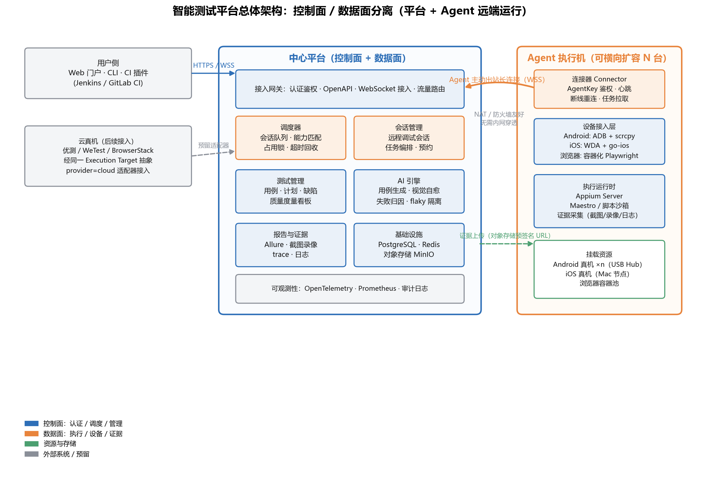
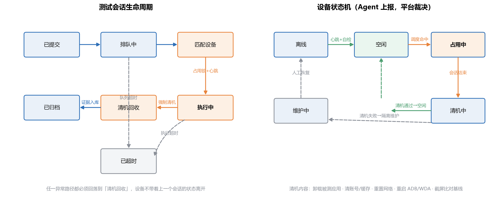

# 智能测试平台架构设计文档（平台 + Agent 远端运行机制）

> 版本：v1.1 ｜ 日期：2026-10-11 ｜ 前置文档：《智能测试平台调研报告》《小团队智能测试落地方案》
> v1.1 变更：按真实规模（个位数在线用户、≤16 并发流水线）裁剪中间件——Redis/MinIO/独立可观测性栈首版不装，接口抽象保留，触发信号见 3.4 与 9.2。
> 适用范围：公司自研智能测试平台（覆盖手机端 Android/iOS 与 Web 端），团队规模 6 名测试 + 20 余名研发。

---

## 1. 设计背景与目标

公司已完成两轮前置决策：

1. **引入智能测试平台的方向已定**：Web 定版 Playwright、移动定版 Appium，测试管理用 MeterSphere 二次开发的路线已在《小团队智能测试落地方案》中收敛；
2. **当前不接云真机**：兼容性要求不高，自建机池优先，云真机仅作为预留扩展点（`provider` 分档设计）。

本文档回答的问题是在此基础上**自研一套"平台 + Agent 远端运行"机制的系统**：设备（真机、模拟器、浏览器容器）挂在分散的 Agent 执行机上，中心平台统一调度、统一会话、统一报告。设计目标：

| 目标 | 说明 | 度量 |
| --- | --- | --- |
| G1 资源池化 | 所有执行资源（真机/浏览器/模拟器）抽象为统一"执行目标"，一处登记、全局调度 | 设备利用率 ≥ 60% |
| G2 远端运行 | Agent 可部署在任意网络位置（办公网、机房、居家办公机），主动出站连接平台 | Agent 跨网段接入零网络改造 |
| G3 会话可信 | 每个会话始于干净设备、终于强制清机，设备不带残留状态流转 | 会话间状态泄漏事故 = 0 |
| G4 小团队可运维 | 6 测试 + 20 研发的规模下，平台自身运维成本 ≤ 0.5 人 | 模块化单体起步，单命令部署 |
| G5 可演进 | 设备规模从 20 台扩到 200+ 台时，架构可平滑拆分而不重写 | 拆分路径在本文档第 9 章固化 |

---

## 2. 市面项目架构调研结论

设计不是凭空而来。以下对 7 个代表性开源/闭源项目的架构解剖是本设计的直接输入，详细出处见文末脚注。

### 2.1 开源项目解剖

**Sonic（国产开源云真机平台，Apache 2.0）**[^1^]
- 结构：Spring Cloud 微服务全家桶（eureka/controller/bus/folder/gateway/transport/task 七个服务）+ Agent 执行机。
- Agent：Spring Boot 应用，通过 WebSocket 主动出站连接中心，用 `AGENT_KEY` 鉴权；设备经 USB Hub 挂在 Agent 所在主机，Agent 用 ddmlib 操作 ADB、Appium Java Client 驱动执行、OpenCV/Tesseract 做图像断言。
- 关键结论：**"Agent 主动出站 + Key 鉴权"模式天然解决 NAT 与跨网段问题**，是本平台直接继承的核心机制；官方建议单 Agent 挂载设备不超过 50 台。
- 反面教材：对 26 人公司，Spring Cloud 七服务 + 注册中心 + 消息总线的运维负担过重，平台自身会变成新的测试对象。

**STF / DeviceFarmer（已被官方弃坑，仅剩社区维护）**[^2^]
- 结构：ZeroMQ + protobuf 消息总线，十几个微服务（triproxy-app/dev、provider、reaper、processor 等），RethinkDB 存状态，provider 每宿主机一个。
- 关键结论：设备 provider 与 UI/API 分离的思路正确；但 12+ 容器对中小团队是过度设计，且仅支持 Android、安全模型假设内网完全可信（无鉴权的 5555 端口模式），原项目弃坑本身就是"架构复杂度超过社区维护能力"的警示。

**Selenium Grid 4（浏览器调度的教科书）**[^3^]
- 结构：Router（对外 4444）→ Session Queue（5559，FIFO + 超时）→ Distributor（5553，维护 GridModel 按 capabilities 匹配）→ Session Map（5556）→ Node（slot 按 stereotype 注册）；组件间用 Event Bus（ZeroMQ pub-sub）解耦。
- 关键结论：**Queue + Distributor + SessionMap 三段式调度模型**是行业共识，本平台调度器直接借用该模型但合并为单进程模块；Grid 4 的 GraphQL 自省、OpenTelemetry 埋点、KEDA 按队列长度自动扩缩也是值得后期引入的设计。

**Appium Device Farm（从插件演进到 Hub-Node）**[^4^]
- 演进：早期是 Appium 插件（LokiJS/SQLite，HTTP 轮询），后重写为 Orchestrator/Runner 分布式架构——Hub 与 Node 用 **WebSocket 持久连接**，PostgreSQL 做多节点并发控制，官方定位 10–500+ 台设备，Node 故障不影响 Hub，内置 OpenTelemetry。
- 关键结论：再次印证两点——①插件式单体在 <10 台设备时够用，超过就要 Hub-Node；②**WebSocket 持久连接优于 HTTP 轮询**（延迟与实时性）。这与 Sonic 的选择一致，本平台采用同一方案。

### 2.2 闭源/商业项目解剖

**AWS Device Farm**[^5^]
- 会话结束即清理设备：擦除用户数据、重置网络配置、必要时重刷 OS 镜像；测试期间 App 级隔离；网络侧用 VPC Endpoint / PrivateLink 做私网接入；IAM 细粒度角色区分开发/测试/管理员。
- 关键结论：**"会话后清机到已知状态"是商业平台的底线能力**，不是可选项；清机失败要有隔离与告警路径（安全社区已有针对"清机被禁用导致持久化植入"的攻击分析）[^6^]。

**HeadSpin（企业级闭源参照）**
- 结构：PBox 硬件 appliance 承载设备，四种部署形态（共享云 / 专属云 / VPC on-prem / 气隙隔离），reverse bridge 采集链路，130+ KPI 性能指标，Auto Device Cleaner 在会话间自动清机。
- 关键结论：部署形态分级（共享→专属→私有化→气隙）本质是按数据敏感度分档，本平台虽只做私有化，但"敏感用例强制路由到受信机池"的策略继承自这一思路。

**Genymotion（模拟器云的远程接入范式）**[^7^]
- 明确警告：ADB over TCP（5555）本身无认证无加密，只能用防火墙白名单或 SSH 隧道兜底。
- 关键结论：**远程调试通道绝不能裸暴露 ADB**，平台的远程 adb 能力必须经过平台侧鉴权中转（参考阿里云真机的"本地 SocketServer 中转云端 adb 流"设计）。

### 2.3 架构对比矩阵

| 维度 | Sonic | STF | Selenium Grid 4 | Appium Device Farm | AWS Device Farm | **本平台决策** |
| --- | --- | --- | --- | --- | --- | --- |
| 部署形态 | 微服务 7+ | 微服务 12+ | 分布式 6 组件 | Hub-Node 双进程 | SaaS | **模块化单体 + 独立 Agent** |
| Agent 连接 | WS 出站 + Key | provider 本地直连 | Node 注册到 Distributor | WS 持久连接 | — | **WSS 出站 + AgentKey（继承 Sonic）** |
| 调度模型 | 自有 | ZeroMQ 消息驱动 | Queue+Distributor+SessionMap | Hub 集中调度 | — | **借用 Grid 4 三段式，单进程实现** |
| Android 投屏 | minicap | minicap | — | — | 私有协议 | **scrcpy server（H.264），预留 WebRTC** |
| iOS 支持 | WDA | ❌ | — | WDA | 私有 | **WDA + go-ios** |
| 会话清机 | 脚本级 | 基础 | 不适用（容器重建） | 基础 | **强清机+镜像重置** | **强清机 + 失败隔离维护** |
| 安全模型 | 内网可信 | 内网可信 | 内网可信 | Token | IAM + PrivateLink | **全链路鉴权 + 审计 + 敏感路由** |
| 可观测性 | 日志 | 弱 | OpenTelemetry | OpenTelemetry | CloudWatch | **OpenTelemetry 埋点，Prometheus 汇聚** |
| 适配规模 | ≤50 台/Agent | 数百 | 数千 slot | 10–500+ | 弹性 | **20 台起步，架构预留 500 台** |

---

## 3. 总体架构

### 3.1 架构总览



系统分为两个物理单元：

- **中心平台（1 套）**：控制面（认证、调度、会话管理、测试管理、AI 引擎）+ 数据面入口（证据接收、报告生成），模块化单体部署；
- **Agent 执行机（N 台）**：部署在任何能访问平台 443 端口的网络位置，设备/浏览器容器挂在 Agent 本地，Agent 主动出站与平台建立 WSS 长连接。

**为什么 Agent 主动出站是唯一正确的方向**：Sonic 与 Appium Device Farm 不约而同选择了这一模式[^1^][^4^]。反向（平台主动连 Agent）要求每个 Agent 所在网络开放入站端口、配置端口映射或内网穿透，在居家办公、多地办公、客户现场等场景全部失效；而主动出站只需出方向 443 放行，NAT、防火墙、跨网段问题全部消失。同时连接由 Agent 发起意味着平台永远知道"这台 Agent 当前可达"，心跳、断线重连、任务下推都在这一条长连接上完成。

### 3.2 控制面与数据面分离

| 平面 | 承载内容 | 通道 | 量级 |
| --- | --- | --- | --- |
| 控制面 | Agent 注册/心跳/能力上报、任务下发、调度指令、会话控制、审计 | WSS 长连接（JSON 消息帧） | 小消息、高频 |
| 数据面 | 屏幕流（H.264）、输入指令（触控/键盘）、证据文件（截图/录像/trace/日志） | 投屏走独立 WebSocket/WebRTC 通道；证据走存储抽象层直传（首版本地磁盘卷，接口兼容 S3） | 大流量、突发 |

分离的理由：控制面要求可靠与顺序，数据面要求吞吐与低延迟，二者 QoS 完全不同；证据直传存储层避免大文件穿透平台业务逻辑（STF 的 processor 链就是反例——所有数据流经消息总线导致总线成为瓶颈）[^2^]。

### 3.3 模块化单体，而非微服务

中心平台采用**模块化单体（Modular Monolith）**：单进程、单部署单元，内部按模块边界（接入网关/调度器/会话管理/测试管理/AI 引擎/报告）划分，模块间通过接口与领域事件通信，禁止跨模块直接读库表。

理由：
1. Grid 4 的六组件分布式是为"数千 slot + 多团队协作"设计的[^3^]，本平台起步规模 20 台设备、个位数并发会话，分布式只带来运维成本不带来收益；
2. STF 的教训是微服务数量超过团队维护能力后项目直接死亡[^2^]；
3. 但调度模型、能力匹配、会话登记这些**逻辑边界**必须现在就按分布式语义设计（占用锁、超时回收、幂等），将来拆出独立调度服务时不需要重新发明协议——演进路径见第 9 章。

### 3.4 规模假设与中间件裁剪（v1.1 修订）

明确的规模假设：**同时在线用户个位数、峰值并发流水线 ≤ 16 条、设备 20 台起步**。在此规模下，原方案的三类中间件裁剪为"接口保留、组件不装"：

| 原组件 | 首版替代 | 裁掉的理由 | 再引入的触发信号 |
| --- | --- | --- | --- |
| Redis（心跳/锁/队列） | PostgreSQL 一库承担：队列表 + `FOR UPDATE SKIP LOCKED`、心跳表 + 租约过期回收 SQL | 个位数用户、十几并发，PG 处理绰绰有余；少一个有状态组件，备份 = 一个数据目录 | 并发任务 > 100 或调度器拆分时 |
| MinIO（对象存储） | 平台本地磁盘卷 + 存储接口抽象（上传/下载/预签名语义不变） | 10 余条流水线的证据量（每天 5–20GB）本地磁盘轻松承载；MinIO 自身运维与内存都是净成本 | 证据 > 2TB 或需要多机共享存储时换 MinIO/OSS |
| OpenTelemetry + Prometheus 栈 | Spring Boot Actuator + 结构化日志 + 平台内置度量表（flaky/利用率本来就要入库做看板），告警由平台算好直推飞书 webhook | 独立可观测性栈对 0.5 人运维是倒挂——监控系统的维护成本超过被监控系统 | 平台服务数 > 3（拆分后）或需跨系统排障时 |

裁剪后的首版运行时：**2 个容器（平台应用 + PostgreSQL）+ N 个 Agent 二进制**，无其他有状态中间件。

---

## 4. 核心组件设计

### 4.1 接入网关（Gateway）

- 对外三类入口：Web 门户（HTTPS）、CLI/CI 插件（HTTPS OpenAPI）、Agent 接入（WSS）。
- 统一认证：用户侧 OIDC/账号密码 + Token；Agent 侧 AgentKey（平台签发、可吊销、绑定 Agent 指纹）。
- 职责只做认证、限流、路由，不含业务逻辑——为将来拆分留干净边界。

### 4.2 调度器（Scheduler）

借用 Selenium Grid 4 的三段式模型[^3^]，单进程内实现三个职责：

```
提交任务 ──► 会话队列（FIFO + 优先级 + 超时）──► 匹配器（Distributor）
                                                    │ 按 capabilities 匹配 Execution Target
                                                    ▼
                                          会话登记表（SessionMap）
                                          占用锁 · 心跳租约 · 超时回收
```

- **执行目标抽象（Execution Target）**：任务只声明能力，不点名设备——`{platform: android, version: ">=13", brand: xiaomi}` 或 `{browser: chrome, version: latest}`。资源描述与 `小团队智能测试落地方案` 第 6 章的 `devices.yaml` 对齐，`provider: local | cloud` 分档保证未来云真机接入时调度协议零变更。
- **匹配算法**：先过滤硬性能力（平台/版本/品牌/标签），再按策略排序——默认"最少占用优先"（均衡磨损），可选"亲和优先"（同一计划的连续用例尽量落同一设备，省安装时间）。
- **占用锁**：匹配成功即写 SessionMap 并下发到 Agent，Agent 确认后置 `占用中`；锁带租约（默认 30s 心跳续租），Agent 断线或超时未确认自动释放，防止"幽灵占用"。
- **队列超时**：任务在队列超过阈值（默认 10 分钟可配）转 `已超时`，明确失败而非无限等待——Grid 4 Session Queue 的同款语义[^3^]。
- **预约机制**：支持占用预约（默认 15 分钟窗口 + 飞书通知提醒），满足人工远程调试场景，借鉴美团云真机的预约占用设计。

### 4.3 会话管理（Session Manager）

会话分两类：**自动化会话**（CI 触发，批量执行）与**远程调试会话**（人工占用单台设备，浏览器内实时投屏操作）。两类会话共用同一状态机与同一套占用锁，区别只在数据面是否开启交互投屏通道。



会话状态机（见上图左）：`已提交 → 排队中 → 匹配设备 → 执行中 → 清机回收 → 已归档`，异常路径（队列超时/执行超时/Agent 断线）统一汇聚到 `已超时` 前仍强制经过清机回收——**任何路径都不允许设备带着上一个会话的状态离开**。

### 4.4 Agent 执行机

Agent 是部署在执行主机上的单一进程（推荐 Go 或 Rust 实现，理由见第 8 章），内部四个子模块：

1. **Connector（连接器）**：WSS 出站连接、AgentKey 鉴权、指数退避重连、心跳（10s）、任务拉取与结果上报。Agent 本地不监听任何入站端口。
2. **设备接入层**：
   - **Android**：ADB（设备枚举/安装/日志）+ scrcpy server（H.264 硬编投屏，35–70ms 延迟，免 root，兼容 minicap 的 banner+JPEG 数据格式以便复用 Sonic 生态组件）；不选 minicap/minitouch 做主投屏，因其 so 需逐 Android 版本适配，小米 8/9、电视类设备有已知兼容坑[^8^]。
   - **iOS**：WebDriverAgent（设备端 WebDriver server，XCTest 框架，8100 端口）+ go-ios（usbmuxd 协议栈，脱离 Mac 也可做安装/日志/性能采集；iOS 17/18 上 go-ios 比 tidevice 更稳）[^9^]。iOS 真机签名仍需要一台 Mac 做 WDA 构建与证书托管，Agent 提供 Mac 模式。
   - **浏览器**：Docker 容器化 Playwright/Selenium 节点，每会话一个一次性容器，天然隔离。
3. **执行运行时**：内嵌 Appium Server（2.x/3.x 瘦 server + uiautomator2/xcuitest driver 独立安装）、Maestro runner、脚本沙箱（限制网络出口与文件系统范围的执行容器）。
4. **证据采集**：截图、H.264 录像、设备日志（logcat/syslog）、Appium 日志、性能采样（CPU/内存/FPS），经存储抽象层直传（首版本地磁盘卷，S3 语义预留），平台只收索引。

### 4.5 远程调试通道（Remote Debug）

人工调试场景需要"像在本地一样 adb"：

- **投屏与操控**：浏览器 ←WSS/WebRTC→ 平台中转 ←WSS→ Agent ←scrcpy→ 设备。首版用 WSS 中转 H.264 帧（实现简单、全平台可控），P2P/SFU 的 WebRTC 作为后续升级路径（sub-500ms 延迟、DTLS-SRTP 强制加密）[^10^]。
- **远程 adb**：平台提供 `platform adb connect <session>` 命令，本地 adb 通过平台鉴权网关中转 adb 流到 Agent——借鉴阿里云真机"SocketServer 中转 + 权限校验"设计，**任何情况下不暴露裸 5555 端口**[^7^]。

### 4.6 报告与证据（Evidence & Report）

- 执行结果结构化（JUnit XML + Allure 格式）入 PostgreSQL；证据文件入本地磁盘证据卷（存储接口抽象，S3 语义预留），平台保存索引与设备指纹（机型/OS/分辨率/Agent ID）。
- 报告页可回放：时间轴对齐截图/录像/日志/网络请求，失败步骤自动定位。
- **flaky 治理**（继承落地方案第 5 章）：每次执行以 `{test_id, commit_sha, verdict}` 记录入仓，EWMA 分数超过阈值（默认 0.15）自动隔离；隔离用例**继续执行但不卡门禁**；离开隔离必须人工决策；看板跟踪 flake rate（告警线 3%）与隔离时长（升级线 14 天）[^11^]。

### 4.7 AI 引擎

与落地方案一致：Midscene.js + 私有化视觉模型（Qwen3-VL/UI-TARS），承担用例生成、视觉自愈、失败归因。架构上 AI 引擎作为独立模块通过平台内部 API 消费证据与用例库，产出"待审核"用例与自愈 diff，**不进入执行关键路径**——AI 服务宕机不影响 CI 门禁链路。

---

## 5. 关键协议设计

### 5.1 Agent 注册与心跳协议（WSS，JSON 帧）

```jsonc
// Agent → 平台：注册（连接建立后第一条消息）
{"type": "register", "agentKey": "ak-xxx", "agentVersion": "1.0.0",
 "host": {"os": "linux", "arch": "x86_64"},
 "targets": [  // 能力声明，而非设备点名
   {"id": "dev-01", "provider": "local", "platform": "android",
    "version": "14", "brand": "xiaomi", "model": "14", "tags": ["核心池"]},
   {"id": "pool-chrome", "provider": "local", "platform": "web",
    "browser": "chrome", "slots": 8}
 ]}

// 平台 → Agent：注册应答（含签发会话令牌与心跳间隔）
{"type": "registered", "sessionToken": "st-xxx", "heartbeatIntervalMs": 10000}

// 双向心跳（含设备状态批量上报）
{"type": "heartbeat", "targets": [{"id": "dev-01", "state": "idle", "battery": 87}]}

// 平台 → Agent：任务下发
{"type": "task.assign", "taskId": "t-123", "sessionId": "s-456",
 "targetId": "dev-01", "leaseMs": 30000,
 "payload": {"framework": "appium", "scriptRef": "git://...", "appRef": "oss://...",
             "timeoutS": 1800}}

// Agent → 平台：任务确认 / 进度 / 完成
{"type": "task.ack", "taskId": "t-123"}
{"type": "task.progress", "taskId": "t-123", "phase": "installing"}
{"type": "task.done", "taskId": "t-123", "verdict": "fail",
 "evidence": {"reportUrl": "oss://...", "videoUrl": "oss://..."}}
```

协议设计要点：
- **幂等**：所有任务消息带 `taskId`，Agent 重连后平台重发未确认任务，重复执行由 SessionMap 去重；
- **租约**：占用即租约，心跳即续租，超时即回收——分布式锁语义内建在协议里；
- **版本协商**：注册消息带 `agentVersion`，平台可拒绝过旧 Agent 并提示升级；
- **证据不经过 WSS**：只传 URL，大文件走对象存储直传。

### 5.2 设备状态机协议

设备状态（见第 4.3 节图右）：`离线 → 空闲 → 占用中 → 清机中 → 空闲 | 维护中`。**Agent 负责上报事实（设备在线/离线/清机结果），平台负责裁决状态**——防止 Agent 侧 Bug 导致脏设备回到空闲池。

清机清单（继承 AWS Device Farm 的会话后清理语义[^5^]，按私有化场景裁剪）：
1. 卸载被测应用及其数据；
2. 清理测试账号、剪贴板、下载目录；
3. 重置网络配置（Wi-Fi 代理/VPN 还原）；
4. 重启 ADB / WDA 会话；
5. 截屏与基线比对（防"清机脚本假成功"），比对失败 → `维护中` 并告警，需人工恢复。

---

## 6. 安全设计

| 层面 | 设计 | 依据 |
| --- | --- | --- |
| 传输 | 全链路 TLS（HTTPS/WSS）；投屏升级 WebRTC 后强制 DTLS-SRTP | 行业标准[^10^] |
| 认证 | 用户 OIDC + RBAC（管理员/测试/研发/只读）；Agent AgentKey 可吊销、绑定主机指纹 | AWS IAM 分角色[^5^] |
| 远程 adb | 平台网关鉴权中转，禁裸 TCP 5555 | Genymotion 安全警告[^7^] |
| 会话隔离 | 浏览器每会话独立容器；真机会话后强制清机 + 截屏基线比对 | AWS Device Farm[^5^] |
| 敏感路由 | 用例打敏感标签 → 调度器强制路由 `provider=local` 且 `tags=受信池` 的设备 | HeadSpin 部署分档思路 |
| 审计 | 会话全量审计日志（谁/何时/占用哪台设备/执行什么/下载什么），保留 ≥ 180 天 | 安全社区对设备农场持久化攻击的检测建议[^6^] |
| 网络 | Agent 仅出站 443；平台部署独立 VLAN，数据库/对象存储不对办公网直开 | STF 内网可信模型的教训[^2^] |

多租户说明：当前单公司单租户，但数据模型中 `workspace_id` 从第一天就存在于用例/计划/设备/会话表，避免将来 SaaS 化或集团多团队时做伤筋动骨的改造。

---

## 7. 可观测性设计

- **埋点**：首版不部署独立可观测性栈（裁剪理由见 3.4）。控制面关键路径（任务提交 → 排队 → 匹配 → 执行 → 清机 → 归档）以结构化日志记录各阶段耗时，Actuator 暴露应用健康与 JVM 指标；trace 语义保留在日志的 `traceId` 字段中，将来引入 OpenTelemetry 时可直接对接，继承 Grid 4 与 Appium Device Farm 的观测模型[^3^][^4^]。
- **核心指标**（入平台度量表，看板直接消费，无需 Prometheus）：
  - 调度：队列长度、平均排队时长、匹配失败率、超时回收次数；
  - 设备：在线率、利用率、清机失败率、单设备日均会话数；
  - 质量：flaky 率（告警线 3%）、隔离用例数、隔离平均时长（升级线 14 天）[^11^]；
  - Agent：连接数、重连频率、任务失败率。
- **告警**：队列积压 > 15 分钟、设备在线率 < 90%、清机失败、flaky 率越线，由平台内置告警模块直推飞书 webhook。

---

## 8. 技术栈选型

| 组件 | 选型 | 备选（不选理由） |
| --- | --- | --- |
| 中心平台后端 | **Java 17 + Spring Boot 3（模块化单体）** | Node.js/NestJS：团队 Java 栈为主，且 Sonic 源码（Java）可直接参考；Go：生态在测试管理域较弱 |
| Agent 执行机 | **Go（单二进制，跨平台）** | Java：Agent 要装在 Mac mini、旧 PC、树莓派上，JVM 体积与内存不划算；Rust：团队无储备 |
| 前端 | Vue 3 + TypeScript + Element Plus | React 亦可，团队 Vue 更熟 |
| 数据库 | PostgreSQL 16（兼作队列/锁/心跳存储，见 3.4） | MySQL 可替代，PG 的 JSONB 适合存 capabilities |
| 队列/锁 | PostgreSQL 一体化（`SELECT ... FOR UPDATE SKIP LOCKED` + 心跳表租约回收） | Redis/RabbitMQ/Kafka：当前规模（个位数用户、≤16 并发流水线）引入即有状态组件运维净成本，触发信号见 9.2 |
| 证据存储 | 本地磁盘卷 + 存储接口抽象（上传/下载/预签名语义，S3 兼容预留） | MinIO：首版证据量级（日均 5–20GB）本地磁盘足够，多机共享或 >2TB 时再引入 |
| 可观测性 | Actuator + 结构化日志（带 traceId）+ 平台内置度量看板 + 飞书 webhook 告警 | OpenTelemetry + Prometheus：0.5 人运维下监控栈维护成本倒挂，服务拆分后引入 |
| Android 投屏 | scrcpy server 协议（H.264） | minicap：逐版本适配成本高[^8^] |
| iOS 链路 | WDA + go-ios | tidevice：iOS 17/18 稳定性弱[^9^] |
| 执行底座 | Appium 2.x + Playwright + Maestro | 已在落地方案定版 |
| 投屏传输 | 首版 WSS 中转 H.264 → 二期 WebRTC | 一步到位 WebRTC：信令/TURN 运维成本对首版过重[^10^] |
| 部署 | docker compose 两个容器（平台 + PostgreSQL）→ K8s Helm（规模到位后） | 起步 K8s：超出团队运维能力 |

**标注假设**：以上栈按"团队以 Java 为主力后端栈"的假设推荐；若团队实际以 Node.js/Go 为主，中心平台可换 NestJS（调度器逻辑不变），决策影响仅限 4.1–4.3 节实现语言，不影响架构。

---

## 9. 部署形态与演进路径

### 9.1 起步部署（M1–M3，20 台设备）

```
一台 4C4G 服务器：中心平台（Spring Boot 单体）+ PostgreSQL + 本地证据卷  ← docker compose 仅 2 个容器
一台 Mac mini：iOS Agent（WDA 构建 + 2–4 台 iPhone）
一台 PC + USB Hub：Android Agent（4–6 台真机；8 核可带 8–12 台）
各研发/测试笔记本：可选浏览器 Agent（容器池）
```

裁剪后资源预算：平台应用 ~768MB（JVM 限额）+ PostgreSQL ~300MB，4C4G 机器余量充足；唯一需要盯的是**磁盘**（证据持续增长，预留 200GB+ 或开启归档策略）与 **USB 供电**（>8 台手机必须用独立供电工业 Hub）。备份 = 数据库 dump + 证据目录，单脚本完成。

### 9.2 演进触发器（不提前拆，按信号拆）

| 信号 | 动作 |
| --- | --- |
| 并发任务 > 100 或调度器拆分 | 队列/锁从 PG 迁出，引入 Redis 或专用调度服务存储 |
| 设备 > 100 台 或 Agent > 10 台 | 调度器拆为独立服务（协议已按分布式语义设计，直接平移） |
| 投屏并发 > 20 路 | 引入 SFU（如 mediasoup），投屏通道独立部署 |
| 证据 > 2TB 或需多机共享存储 | 本地磁盘卷切到 MinIO/公有云 OSS（存储接口抽象不变，仅换实现） |
| 平台服务数 > 3 或需跨系统排障 | 引入 OpenTelemetry + Prometheus 可观测性栈 |
| flaky 治理需求深化 | 接入 EWMA 自动隔离已有，再评估 AI 归因独立服务化 |
| 云真机接入 | 实现 `provider=cloud` 适配器（优测/WeTest OpenAPI），调度协议零变更 |

---

## 10. 风险与对策

| 风险 | 等级 | 对策 |
| --- | --- | --- |
| iOS WDA 签名与证书维护成本 | 高 | Mac mini 固定为签名节点；证书轮换写入运维手册；优先保证 Android + Web 覆盖，iOS 从 2 台核心机起步 |
| scrcpy 在个别机型兼容问题 | 中 | 保留 minicap 降级通道；问题机型打标签进维护池 |
| Agent 断连导致设备"幽灵占用" | 中 | 租约 + 超时回收协议内建；回收后强制清机再回池 |
| 平台自身变成测试负担（STF 前车之鉴） | 高 | 模块化单体 + docker compose 单命令部署；平台自身的 CI 用平台跑（吃自己的狗粮） |
| 6 人测试团队消化不了平台 | 高 | 与《小团队智能测试落地方案》节奏对齐：P1 先框架统一，平台在 P2 才进入主线；AI 能力最后接 |
| 远程 adb 中转被滥用 | 中 | 会话级鉴权 + 审计 + 命令白名单（禁 `adb shell pm install` 以外的写操作可按需收紧） |

---

## 脚注（数据来源）

[^1^]: Sonic 官方文档与源码架构（SonicCloudOrg/sonic-server），Spring Cloud 微服务 + Agent WebSocket 出站连接、AGENT_KEY 鉴权、单 Agent 设备上限建议。
[^2^]: DeviceFarmer/STF 仓库（github.com/DeviceFarmer/stf），ZeroMQ + protobuf 微服务结构、RethinkDB、Android-only，原 openstf 项目已停止维护。
[^3^]: Selenium Grid 4 官方文档，Router/Session Queue/Distributor/Session Map/Event Bus/Node 组件职责与端口、KEDA 自动扩缩、OpenTelemetry 支持。
[^4^]: Appium Device Farm 官方文档（docs.devicefarm.org），"Plugin vs Orchestrator/Runner"架构演进对比表：WebSocket 持久连接、PostgreSQL、OpenTelemetry、10–500+ 设备定位。
[^5^]: AWS Device Farm 文档：会话后设备清理（擦除用户数据、重置网络、重刷镜像）、App 隔离、VPC PrivateLink、IAM 细粒度权限。
[^6^]: HackTricks《AWS Device Farm Persistence》：禁用清机导致的持久化植入风险与检测建议（会话前后校验设备状态、定期重刷私有设备）。
[^7^]: Genymotion 文档：ADB over TCP 无认证无加密，必须防火墙白名单或 SSH 隧道。
[^8^]: minicap/minitouch 在小米 8/9 及电视类设备的 so 兼容问题（Sonic 社区 issue 汇总）；scrcpy server 方案：H.264 硬编、35–70ms 延迟、免 root、兼容 minicap 数据格式。
[^9^]: go-ios 与 tidevice 在 iOS 17/18 usbmuxd 协议适配上的社区对比；WebDriverAgent 基于 XCTest、8100 端口。
[^10^]: WebRTC 实时传输：sub-500ms 延迟、DTLS-SRTP 强制加密、P2P/SFU 拓扑。
[^11^]: Flaky 隔离工程实践：EWMA 分数 + 阈值隔离（默认 0.15）、隔离继续执行但不卡门禁、离开隔离须人工决策、flake rate 3% 告警线与 14 天隔离时长升级线。
