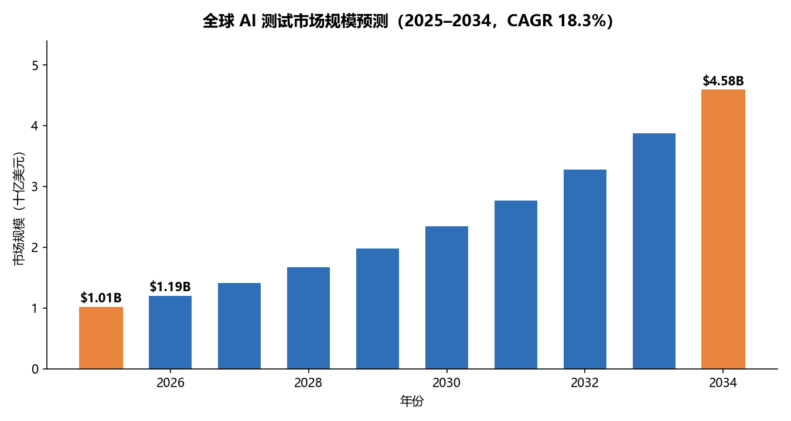
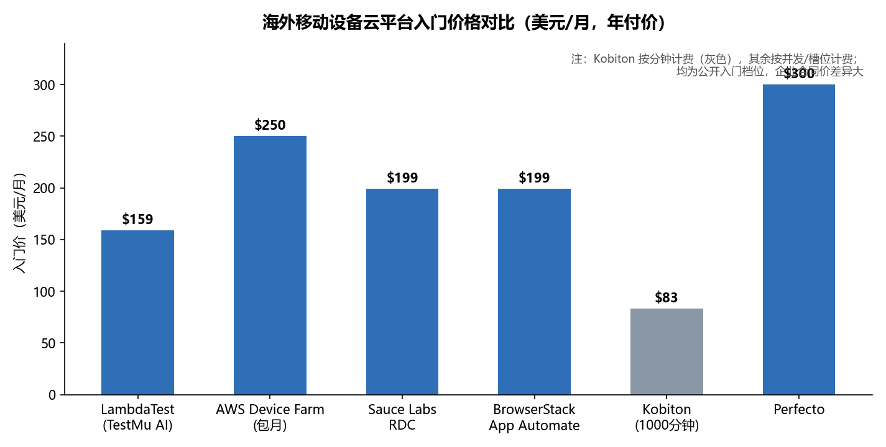
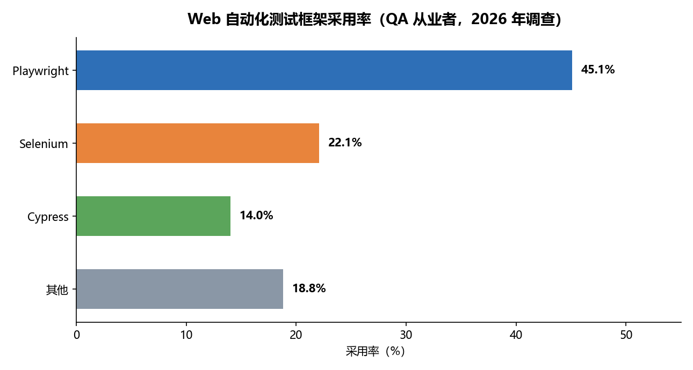
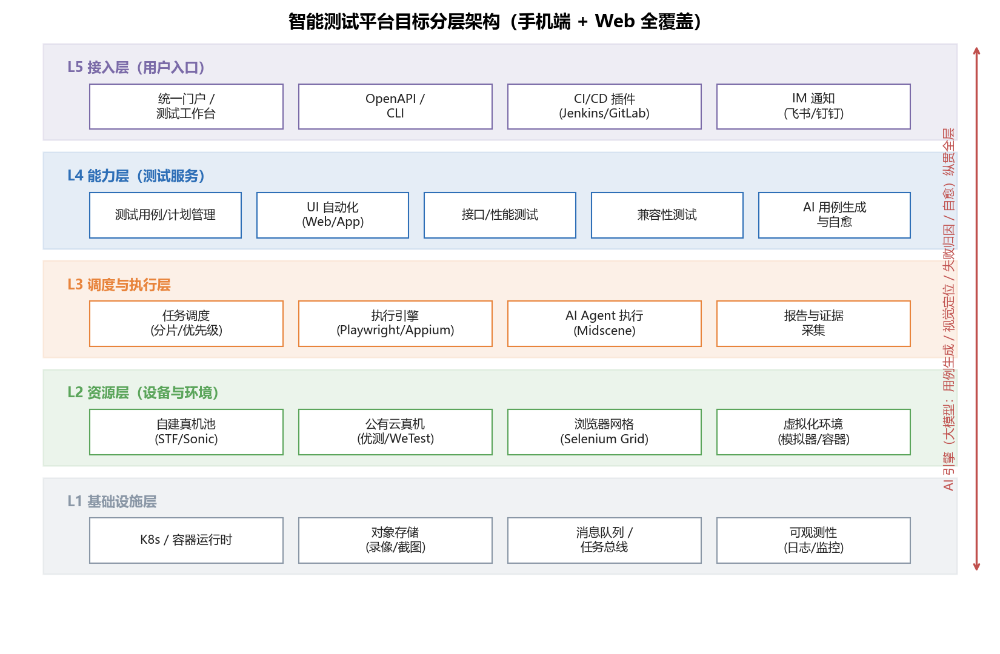

# 智能测试平台调研报告：商业与开源格局、企业引入路径与目标架构（手机端 + Web 全覆盖）

> 调研日期：2026-10-11
> 配套交付：本报告 + `openspec/` 目录下的规范驱动引入计划（proposal / design / tasks / specs）

---

## 0. 执行摘要

**一句话结论：对一家同时需要覆盖手机端（Android / iOS / 鸿蒙）和 Web 端的公司，最优解不是"买一个平台"或"从零自建"，而是"开源框架为骨架 + 商业云真机补资源 + 开源 AI 引擎做智能化"的混合架构，并分四个阶段、用 6–12 个月推进到"平台化"成熟度。**

关键论据：

- **市场侧**：AI 测试市场正处于高速成长期，Fortune Business Insights 口径下 2025 年全球规模约 **10.1 亿美元**，预计 2034 年达 **46.4 亿美元**（CAGR 18.3%）；多家研究机构一致认为"自动化→智能化"是 2025–2026 年测试行业的主线。[^1^][^2^]
- **商业侧**：国内以腾讯优测、腾讯 WeTest、Testin 云测为三大主力（**阿里云移动测试国内站已公告 2026-06-01 停止服务**，选型时须排除或规划迁移）；海外以 BrowserStack（30,000+ 真机）、Sauce Labs（2024 年被 Tricentis 以 13.3 亿美元收购）、LambdaTest/TestMu AI（价格杀手，入门 $15–159/月）为代表。[^3^][^4^][^5^]
- **开源侧**：Web 端 Playwright 已成为新项目的事实标准（QA 从业者采用率约 **45%**，超过 Selenium 的 22%）；移动端 Appium 仍是跨平台底座，Maestro 以 YAML 低门槛快速崛起；**AI 原生开源工具（字节 Midscene.js、UI-TARS、Qwen3-VL）已可用自然语言 + 纯视觉方式驱动 Web/Android/iOS/鸿蒙/桌面端**，token 成本较 DOM 方案下降约 80%，这是本轮"智能化"最大的技术变量。[^6^][^7^][^8^]
- **引入路径**：参照 CNCF 平台工程成熟度模型（临时→运营→可扩展→优化）与测试平台化实践，企业应走"**框架级自动化 → 平台化 → 智能化**"三级路线；资源层采用"自建小机池（核心回归）+ 商业云真机（兼容性广度）"的混合模式，这是当前金融、车联网行业的主流做法。[^9^][^10^]

---

## 1. 市场格局与 2026 年趋势

### 1.1 市场规模与增速

不同研究机构对"AI 测试"的统计口径差异较大：Fortune Business Insights 的窄口径（AI-enabled testing 软件与服务）2025 年为 10.1 亿美元、2034 年预计 46.4 亿美元、CAGR 18.3%；Market Research Future 的宽口径（含测试服务与外包）2024 年即达 575.5 亿美元、CAGR 27.49%。**两份报告数值差近两个数量级，建议内部汇报采用窄口径并注明口径来源**，但两者对增长方向和驱动因素的判断一致：自动化渗透率提升、AI 与 DevOps 融合、软件复杂度上升。[^1^][^2^]

细分市场还有两个结构性信号值得关注：按部署模式，**2026 年云端部署预计占 62.8%**，说明云真机/云网格仍是资源层的主流获取方式；按应用形态，**Web 端测试占约 70.2%**，移动端占比小但增速更快（移动测试细分市场 CAGR 约 16.8%）——这印证了对一家公司而言"Web 先行、移动补广度"的投入顺序是符合行业资金投向的。[^2^][^11^]

### 1.2 2026 年三大趋势

综合国内行业分析，2026 年测试行业呈现三条清晰主线[^12^]：

| 趋势 | 含义 | 对引入决策的影响 |
| --- | --- | --- |
| 从"自动化"到"智能化" | AI 预测缺陷位置、自动生成用例；腾讯 TAPD 依托大模型宣称测试效率提升 300%；多智能体 LLM 已能模拟多用户协同操作场景 | AI 能力不再是加分项而是必选项，但应作为"引擎层"引入而非推倒重来 |
| 从"功能验证"到"体验验证" | 测试范畴扩展到多模态交互、跨设备生态（手表/车机/家居）、体验连续性 | 资源层需预留鸿蒙、车机、IoT 设备接入能力 |
| 从"公有云"到"混合与私有" | 金融、医疗等大型企业出于数据安全构建私有设备农场；Testin 等厂商提供私有化部署方案 | 资源层架构必须同时支持公有云真机与自建机池两种供给 |

另一个必须注意的市场事件：**阿里云移动测试（EMAS 体系）国内站已公告将于 2026 年 6 月 1 日停止服务**，存量用户需提前迁移。这意味着国内商业云真机市场进一步向腾讯系（优测、WeTest）与 Testin 集中，议价时供应商集中度风险应纳入考量。[^4^]

### 1.3 AI 测试的落地形态：从"辅助"到"Agentic"

2026 年最重要的变化是 AI 测试从"辅助功能"进化为"自主 Agent"。截至 2026 年中，主流厂商的 Agent 产品已陆续交付：Sauce Labs 于 2026 年 7 月发布 AURA 闭环平台，mabl 推出 Agentic Tester / Active Coverage，Tricentis 发布 AI Workspace（协调四个 Agent 的控制塔），Katalon 上线 Run with AI（prompt 到可执行脚本），TestMu AI 的 KaneAI 支持自然语言创建、规划与调试测试。[^13^]

但落地时必须保持清醒：行业平均脚本失效率约 30%，即便头部 AI 平台（Functionize 宣称 3–5%）也远未到"无人值守"的程度。**正确姿势是"AI 生成 + 人工审核"的人机协同**：要求 AI 生成的新用例必须经人工评审、监控误报率并调阈值、保留失败到代码变更的追溯记录。开源侧的 UI-TARS 模型也明确承认局限：任务步骤超过 12 步时误判率显著上升，关键决策仍需交还人类。[^13^][^14^][^8^]

---

## 2. 商业平台调研

### 2.1 国内商业平台

国内市场的核心玩家与定位如下（腾讯内部同时存在优测、WeTest、云手机 CVP 三个产品，定位不同，选型时极易混淆）[^15^][^4^]：

| 平台 | 定位 | 真机规模 | AI 能力 | 计费/部署 | 适用场景 | 风险提示 |
| --- | --- | --- | --- | --- | --- | --- |
| **腾讯优测（UTest）** | AI 赋能的一站式云测试服务平台 | 官方标注 3000+ 真实手机 | AI 探索测试（自然语言描述目标，Agent 在真机执行） | 按需计费，支持私有化/行业方案 | 企业级持续测试：兼容、远程调试、接口/性能/安全、测试管理一体化；金融、车联网、泛互联网 | 与 WeTest 定位重叠，需按"质量体系"还是"游戏性能"区分 |
| **腾讯 WeTest** | 游戏与高性能应用质量平台 | 千台级，覆盖安卓/鸿蒙/iPhone | 2025-10 上线 QAgent，宣称智能问题定位提升效率 300%；PerfDog 性能分析、CrashSight 崩溃分析 | 产品化按需计费，门槛低 | 游戏、高性能 App、出海应用、帧率/卡顿/崩溃专项 | 泛 App 全流程测试管理非其强项 |
| **Testin 云测** | AI 驱动的零代码自动化测试 | 超 2000 款真机，含历史机型与信创/鸿蒙 | XAgent：用例自动生成 + 脚本自愈（RAG 融合企业私有知识库，宣称跨系统交互覆盖率提升 40%+） | 订阅 + 私有化方案 | 追求自动化广度、关注国产化与鸿蒙适配的企业 | 头部厂商私有化方案报价不透明 |
| **阿里云移动测试** | 与 EMAS 深度集成的云原生测试 | 约 1500 款真机 | 智能探索引擎 Ripper | 订阅 | 已深度绑定阿里云 EMAS 的团队 | **国内站 2026-06-01 停服，不建议新引入** |
| **厂商自建平台**（小米/华为/OPPO/vivo/三星云测） | 单一厂商设备专项测试 | 各自品牌全系列 | 基础自动化 | 多为开发者认证后免费/低价（小米每日 30 次免费调试） | 上架前厂商专项验证、特定机型问题复现 | 不能替代多品牌综合覆盖 |

补充一个常被忽视的资源：百度云测 MTC、各厂商开放平台对"上架合规 + 厂商机型"验证是免费或极低成本的，适合作为兼容性矩阵的补充层而非主干。[^16^]

### 2.2 海外设备云与价格体系

海外市场以"按并发会话计费"为主流定价模型，分钟数通常不限——**并发数才是真正的成本杠杆**，评估时应先估算所需并发（套件总时长 ÷ 可接受的墙钟时间），再横向比价[^5^]：

| 平台 | 计费模型 | 入门价（年付） | 真机规模 | 5 并发月成本 | 企业合同年均价 | 决策要点 |
| --- | --- | --- | --- | --- | --- | --- |
| **BrowserStack** | 按并发 | $199/并发/月（App Automate） | 30,000+ 设备单元，设备广度第一 | ~$995 | ~$32K（大客户 $50K–100K） | 设备覆盖优先、预算不敏感时选它 |
| **LambdaTest / TestMu AI** | 按并发 | $159/并发/月（自动化），Live 低至 $15 | 10,000+ 真机 | ~$795 | $15K–25K | 价格最优（约低 20–30%），但用户反馈设备延迟与"请求 iPhone 真机却分配到模拟器"的稳定性问题 |
| **Sauce Labs** | 按并发（VDC/RDC 分离） | RDC $199/月，Virtual $149/月 | 数千真机 + 强模拟器 | ~$745 | $16K–95K | 合规优先（SOC2/HIPAA）、企业治理、长期分析；2024 年被 Tricentis 以 $1.33B 收购 |
| **Kobiton** | 按分钟 | $83/月（1000 分钟） | 真机，支持云/本地/混合 | 不适用 | $9K–50K | 分钟制对低频使用友好，但回归套件放大后账单不可预测（用户实测预估 3000 分钟实际 7200） |
| **AWS Device Farm** | 按分钟或槽位包月 | $0.17/设备分钟 或 $250/槽位/月 | 真机 | $1,250（5 槽位） | ~$3K | AWS 原生团队、使用不规律时性价比最高 |
| **HeadSpin** | 设备槽位 | $49/月起 | 全球 SIM 卡真实硬件 | 定制 | $42K–48K | 性能体验分析、真实运营商网络场景 |
| **Perfecto** | 按并发 | $300/月 | 真机 | 定制 | $15K–100K | 企业集成深度 |

对国内公司而言，海外云的直接适用场景主要是**出海 App 的海外机型与网络验证**；国内业务的真机覆盖仍应依赖国内平台或自建，因为国内主流 ROM（MIUI、ColorOS、鸿蒙）与海外设备池的机型结构差异巨大。[^5^][^17^]

### 2.3 AI 测试 SaaS 平台

这是"智能测试平台"概念最集中的商业阵营，2026 年的格局如下[^13^][^18^][^19^]：

| 平台 | 核心 AI 能力 | 移动端支持 | 价格带 | 适合谁 |
| --- | --- | --- | --- | --- |
| **mabl** | Agentic Tester + Active Coverage（持续运行的五项能力：指令、云端生成、运行时恢复、结果分析）；API + UI 一体化最成熟 | 原生 iOS/Android（云设备农场），三者中移动端最强 | 报价制，中型团队约 $4K–10K/月 | 追求 API+UI 统一、移动优先的团队；2024 营收 $17.9M（+37%），客户含 Workday、JetBlue |
| **Testim（Tricentis）** | Smart Locators 自愈定位；Agentic Test Automation | 经 BrowserStack/Sauce Labs 集成，体验较弱 | 报价制 | 已用 Tricentis 全家桶（Tosca/qTest）的企业 |
| **Functionize** | NLP 自然语言编写测试（英语描述→可执行用例）；宣称失效率 3–5%（行业均值约 30%） | 限移动 Web，原生 App 弱 | 免费档 + $20/月起 | 非工程人员编写测试、企业 ServiceNow 生态 |
| **Applitools** | Visual AI 视觉回归（像素级跨浏览器/设备比对）；Autonomous 自主测试 | 强（视觉测试天然适配多端） | 报价制 | 视觉质量要求高（金融/电商 UI 改版频繁）的团队 |
| **Katalon** | 全栈（Web/移动/API/桌面）+ Run with AI（prompt→脚本，2026-04 beta） | 支持 | $70/席位/月起 | 低代码到专业代码混合团队 |
| **TestMu AI（原 LambdaTest）** | KaneAI（自然语言创建/规划/调试）+ HyperExecute 编排 | 10,000+ 真机 | $15/月起 | 预算敏感 + 需要设备云一体 |
| **Tricentis Tosca** | 模型驱动 + Vision AI + AI Workspace（四 Agent 控制塔） | 支持 | 报价制 | SAP/企业级、强合规审计场景 |

三个关键判断：其一，**这批工具之间迁移成本极高**（各家 DSL、定位策略、用例格式互不兼容，迁移 100 条用例约需 2–4 周，全量迁移 6–12 个月），首次选型务必 PoC 验证后再签长约[^18^]；其二，2025–2026 年并购整合加速（Tricentis 收 Testim 与 Sauce Labs），供应商格局仍在剧烈变动，合同应保留退出条款；其三，Forrester 2026 年评测中 UiPath、Tricentis、ACCELQ、Qyrus 位列领导者，Applitools、Functionize 为 Strong Performer，可作为短名单的第三方佐证。[^19^]

---

## 3. 开源 / 非商业方案调研

### 3.1 Web 端自动化框架

Web 端的竞争在 2026 年已基本分出胜负：**Playwright 是新项目的默认选择**。截至 2026 年 4 月，其 npm 周下载量超 3000 万（2021 年不足 100 万），GitHub Star 数超过 Cypress 与 Selenium 之和；2026 年调查中 QA 从业者采用率约 45.1%，Selenium 约 22.1%，Cypress 约 14%。独立基准测试中，Playwright 的 100 用例套件执行最快（Cypress 慢约 23%，Selenium 慢约 42%），且 flaky 率最低——自动等待与 web-first 断言消除了 Selenium 时代最大的不稳定来源。[^6^][^20^]

| 维度 | Playwright | Selenium | Cypress |
| --- | --- | --- | --- |
| 架构 | CDP 直连浏览器（Chromium/Firefox/WebKit 三引擎统一 API） | W3C WebDriver 标准协议（HTTP 桥） | 浏览器内 JS 执行 |
| 自动等待 | 内置，全操作 | 手动 WebDriverWait | 内置，多数操作 |
| 并行 | 原生分片/worker | 需自建 Selenium Grid | 付费 Cypress Cloud |
| 语言 | TS/JS、Python、Java、C# | 最广（含 Ruby、Kotlin） | 仅 JS/TS |
| 移动端 | 仅移动 Web 模拟，不支持原生 App | 经 Appium 支持原生 | 不支持 |
| 调试 | Trace Viewer（DOM 快照+网络+控制台） | 生态成熟但分散 | 时间旅行调试 |
| 适用 | 新项目默认、现代 SPA | 存量企业套件、多语言团队、真 Safari/Edge 标准合规 | JS 团队组件测试、最快反馈环 |

迁移视角：中型套件（200–500 条）从 Selenium 迁到 Playwright 约需 2–4 个月，迁移后通常获得约 42% 的执行提速与 60% 的 flaky 下降；AI 辅助迁移工具可再省约 30% 人力。**对存量 Selenium 资产不必强迁，新项目用 Playwright 即可**。[^6^]

### 3.2 移动端自动化框架

移动端呈"一老一新"格局，加一个 React Native 专用选项[^21^][^22^][^23^]：

| 维度 | Appium | Maestro | Detox |
| --- | --- | --- | --- |
| 测试方式 | 黑盒（WebDriver 协议，驱动 XCUITest/UIAutomator2） | 黑盒（声明式 YAML flow） | 灰盒（与 RN JS 线程同步） |
| 平台 | iOS/Android/混合/移动 Web/桌面 | iOS/Android/RN/Flutter/Web | 仅 React Native |
| 编写门槛 | 高（需编程 + SDK/驱动配置） | 极低（YAML，非技术人员可写） | 中（JS/TS） |
| 执行速度 | 中（网络往返延迟） | 快（轻量 runner，实测快 2–3 倍：结账流 12–18s vs 30–45s） | 快（自动同步） |
| Flaky 率 | 中高（手动等待） | 很低（智能同步） | 低 |
| 生态 | 最成熟，所有商业云真机原生支持 | 成长中，云支持在完善 | 社区较小，发版放缓 |
| 长期维护 | 高（UI 变更即 locator 失效） | 中低 | 中 |

**选型结论：跨平台原生 App 的底层引擎仍应选 Appium**——因为它是所有商业云真机（优测、BrowserStack、Sauce）和开源设备农场（STF/Sonic）的共同协议底座，放弃它等于放弃整个资源层生态；Maestro 适合作为冒烟与核心流程的补充层，显著降低编写和维护门槛；团队若是纯 React Native 技术栈可在项目级引入 Detox。平台级则应把"框架可插拔"作为设计要求。[^21^]

### 3.3 AI 原生开源工具：本轮最大的技术变量

2025–2026 年开源社区出现了一类新工具：让 LLM 直接驱动真实浏览器/设备，用视觉或意图而非选择器定位元素，用自然语言描述测试。值得重点关注的有[^24^][^25^]：

| 工具 | 机制 | 覆盖端 | 语言/协议 | 亮点数据 |
| --- | --- | --- | --- | --- |
| **Midscene.js**（字节 Web Infra，MIT） | 纯视觉驱动：截图→多模态模型（Doubao Seed / Qwen3-VL / UI-TARS）→坐标→Playwright/ADB 执行；提供 aiTap/aiInput/aiAssert/aiQuery 与自然语言 Gherkin BDD | **Web、Android、iOS、鸿蒙、Windows/macOS/Linux 桌面——一份 API 全覆盖** | TypeScript | GitHub 14k+ Star；v1.0 全面转视觉方案后 token 用量降约 80%；可私有化部署开源模型（Qwen3-VL 8B/30B） |
| **UI-TARS**（字节，开源模型） | GUI 专用原生 Agent 模型，截图+指令→下一步动作，具备反思纠错 | 任意可截图界面 | 模型权重开源（7B/72B 等） | 与 Midscene 组合实现目标驱动（而非步骤驱动）自动化；局限：>12 步任务误判率上升 |
| **Skyvern**（AGPL-3.0） | Planner-Actor-Validator 三环 + 视觉 LLM + Playwright 执行 | Web | Python | WebVoyager 基准 85.85%，表单填写类 SOTA；支持 2FA/CAPTCHA |
| **Browser Use**（MIT） | LLM Agent 全权控制真实浏览器 | Web | Python | WebVoyager 89.1% |
| **Stagehand**（MIT） | 在 Playwright 上加 act/extract/observe AI 原语 | Web | TypeScript | 渐进式：稳定步骤走代码，易变步骤走 AI |

对一家要自建智能测试平台的公司，**Midscene.js + 私有化视觉模型（Qwen3-VL/UI-TARS）是目前唯一能同时覆盖手机端与 Web 端、且不依赖商业大模型的开源 AI 引擎方案**——这直接解决了两个核心顾虑：商业模型外传数据的合规风险，以及按 token 计费的不可控成本。Skyvern 等 AGPL 项目需注意 copyleft 对内部商用的约束。[^25^][^24^]

### 3.4 测试管理与执行平台（开源）

| 平台 | 定位 | 能力边界 | 注意点 |
| --- | --- | --- | --- |
| **MeterSphere** | 开源持续测试平台：测试管理 + 接口测试 + 团队协作，内置大模型 AI 助手（生成用例） | v3.x 已剥离性能与 UI 测试（UI 测试在企业版 X-Pack） | Docker 一键部署；插件市场可接 Jenkins/Jira/禅道；企业版收费 |
| **RunnerGo** | 开源全栈测试平台 | 接口/性能/UI/测试管理一体，MCP + AI 自动编排 | 团队与生态规模小于 MeterSphere |
| **Sonic** | 开源分布式云真机测试平台（Spring Cloud 微服务 + Vue） | Android/iOS 远控、0 编码 UI 自动化、图像识别、CI 对接、钉钉/飞书通知 | 面向中小企业；设备硬件自购 |
| **STF / DeviceFarmer** | 开源手机远程管理平台（Web 浏览器远控、ADB、日志、安装） | Android 成熟，iOS 支持长期在路上 | 安全假设为内网可信环境，多租户需自行加隔离；维护投入靠社区业余时间 |

开源平台的价值不在"免费"而在"可控与可二开"：商业平台按席位/用量收费且功能固定，开源方案的真实成本是硬件采购 + 运维人力。行业共识是**中小规模用商业公有云，上规模或强合规模块用开源自建**。[^26^][^27^]

---

## 4. 商业 vs 开源 vs 自建：对比与决策框架

### 4.1 三路线 TCO 对比

| 维度 | 纯商业采购（云真机/AI SaaS） | 纯开源自建 | 混合（推荐） |
| --- | --- | --- | --- |
| 首年现金成本 | 中（$10K–60K/年量级，视并发数） | 低软件成本 + 高硬件/人力（设备池 10–20 台核心机型 + 1–2 名专职） | 中（核心自建 + 长尾外购） |
| 3 年 TCO | 随用量线性增长，回归规模放大后显著上升 | 前期高、后期摊薄；设备约 2 年换血周期 | 最优：高频核心路径跑自建（边际成本近零），长尾兼容跑云 |
| 数据合规 | 依赖供应商私有化选项 | 完全可控 | 敏感业务留内网，非敏感上云 |
| 能力上限 | 受供应商路线图约束 | 受团队工程能力约束 | 双通道互补 |
| 锁定风险 | 高（AI SaaS 迁移 100 用例约 2–4 周） | 低 | 中（测试逻辑层用标准协议解耦） |
| 见效速度 | 快（周级） | 慢（季度级） | 中 |

自建设备农场的隐性成本必须正视：设备通常 2 年左右过时需更新，需要 USB 链路、供电、机架、定期重置与现场维护；STF 官方也明确提示其安全模型假设内网可信，多租户环境需自行建设隔离。因此自建只应覆盖"每日高频回归所需的 10–20 台核心机型"，广覆盖兼容性测试交给商业云更经济。[^28^][^29^]

### 4.2 决策框架（按公司约束条件）

| 约束条件 | 推荐路线 |
| --- | --- |
| 团队 <5 人、无专职测试开发 | 直接采购商业平台（优测按需计费 / TestMu AI $15 起），不自建任何基础设施 |
| 有 CI/CD、迭代快、机型需求集中在国内主流 | 开源框架（Playwright + Appium）+ 商业云真机（优测/WeTest），平台层用 MeterSphere 起步 |
| 金融/医疗等强合规、数据不出内网 | 自建机池（Sonic/STF）+ 私有化视觉模型（Qwen3-VL）+ 商业平台私有化部署版本（Testin/优测均提供） |
| 有出海业务 | 叠加 BrowserStack（广度）或 AWS Device Farm（成本）做海外机型层 |
| UI 改版频繁、脚本维护成本失控 | 引入 AI 自愈/视觉驱动层（Midscene 开源 或 Applitools/mabl 商业），这是 ROI 最直接的 AI 切入点 |

---

## 5. 企业引入路径：成熟度模型与"做到什么程度"

### 5.1 成熟度分级

参照 CNCF 平台工程成熟度模型与"自动化→平台化→智能化"的建设路径，将智能测试平台的引入划分为四级[^9^][^30^]：

| 级别 | 名称 | 特征 | 退出标准（做到什么程度算完成） |
| --- | --- | --- | --- |
| L0 | 脚本级自动化 | 各项目各自写脚本，无统一框架与资产沉淀 | — |
| L1 | 框架级自动化 | 统一 Web（Playwright）与移动（Appium）框架、页面对象/组件库、接入 CI，PR 级冒烟门禁 | 核心流程冒烟 <5 分钟；新代码行覆盖率门槛生效；flaky 率 <5% 可度量 |
| L2 | 平台化 | 统一测试管理平台（用例/计划/执行/报告/缺陷闭环）、统一资源调度（自建机池 + 云真机）、质量度量看板 | 回归全量 <30 分钟；设备/浏览器资源池化按需分配；测试资产线上化率 100%；质量数据可回溯审计 |
| L3 | 智能化 | AI 用例生成（人工审核制）、视觉自愈、失败智能归因、基于变更的测试选择（Test Impact Analysis） | AI 生成用例占比可度量且有审核流；UI 改版后脚本自愈率 >80%；失败归因建议采纳率 >50% |
| L4 | 持续质量（优化级） | shift-left 与 shift-right 闭环：生产遥测/崩溃数据回流自动生成回归用例 | 线上缺陷转化为永久回归用例的闭环 SLA；质量门禁成为发布决策依据 |

**务实建议：大多数公司 12 个月内的合理目标是 L2 收尾 + L3 试点，而不是一步到 L4。** 行业数据显示 2025 年约 70% 的企业已部署某种 AI 测试工具，但真正跑通"生成-审核-自愈-归因"闭环的是少数；AI 预计可节省约 40% 测试成本，同时伴随误报（训练数据不足时误报率可达 15%）与技能断层风险，需要配套的评审制度与人员培训。[^31^]

### 5.2 四阶段实施路线图

| 阶段 | 周期 | 目标 | 关键动作 | 里程碑/验收 |
| --- | --- | --- | --- | --- |
| P0 诊断与基线 | 第 0–1 月 | 摸清现状、定基线 | 盘点现有用例/脚本/设备资产；统计缺陷逃逸率、回归耗时、flaky 率；用分析工具数据确定 Top 20 覆盖机型与浏览器矩阵 | 输出《测试现状与基线报告》；确定量化目标 |
| P1 框架统一 | 第 1–3 月 | L1 | Web 新项目定版 Playwright、移动端定版 Appium；搭建 Selenium Grid/浏览器容器池；接入 CI，PR 冒烟门禁上线；采购 1 个商业云真机账号（如优测）跑通主链路兼容 | 冒烟门禁生效；Top 20 机型主链路可一键回归 |
| P2 平台化 | 第 3–8 月 | L2 | 部署 MeterSphere（或等价平台）承载用例/计划/报告；自建 10–20 台核心机池（Sonic）并与云真机统一调度；缺陷双向同步（Jira/禅道/TAPD）；质量看板上线 | 测试资产线上化 100%；全量回归 <30 分钟；资源利用率可观测 |
| P3 智能化试点 | 第 8–12 月 | L3（试点） | 引入 Midscene + 私有化视觉模型做 2 条业务线的 UI 自愈试点；大模型生成接口/功能用例（人工审核入库）；失败归因与 flaky 自动隔离 | 试点线 UI 维护工时下降 >50%；AI 用例审核通过率与误报率可度量 |

每阶段都遵循"先在 1–2 条业务线验证、再横向推广"的原则；P3 的 AI 能力必须带人工审核门禁，不允许 AI 生成用例未经评审直接进入门禁链路。[^30^][^32^]

---

## 6. 目标架构（手机端 + Web 全覆盖）

架构分五层，AI 引擎作为横切能力纵贯全层：

- **L1 基础设施层**：Kubernetes/容器运行时承载全部执行环境；对象存储保存截图/录像/trace；消息队列承载任务总线；统一日志与监控。
- **L2 资源层（设备与环境）**：四类资源统一抽象为"可调度执行目标"——自建真机池（Sonic/STF，核心机型高频回归）、公有云真机（优测/WeTest，长尾兼容与出海叠加 BrowserStack）、浏览器网格（Selenium Grid/Playwright 容器池）、虚拟化环境（模拟器/仿真器，冒烟用）。统一抽象的意义在于：测试任务声明"要什么机型/浏览器"，由调度层决定去哪个池执行，业务方无感知。
- **L3 调度与执行层**：任务分片与优先级调度；执行引擎可插拔（Playwright/Appium/Maestro）；AI Agent 执行通道（Midscene 视觉驱动）；证据采集（截图、录像、trace、性能数据）。
- **L4 能力层（测试服务）**：用例与计划管理、UI 自动化（Web/App）、接口/性能、兼容性矩阵、AI 用例生成与自愈。
- **L5 接入层**：统一门户、OpenAPI/CLI、CI/CD 插件、IM 通知。

**手机端覆盖策略**：Android 主流通路 = Appium 引擎 + 自建机池（核心）+ 优测/WeTest（长尾 + 鸿蒙机型）；iOS 依赖 macOS 执行节点（XCUITest），自建 Mac 集群或采购云 iOS 真机；鸿蒙经云真机覆盖（优测/Testin 均支持）；小程序/H5 走 Web 链路复用。**Web 端覆盖策略**：Playwright 为默认引擎，Selenium Grid 承接存量与真 Safari/Edge 合规场景，移动端 H5 用 Playwright 设备模拟 + 真机云抽检。

---

## 7. 风险清单

| 风险 | 等级 | 缓解措施 |
| --- | --- | --- |
| 供应商集中/停服（阿里云移动测试 2026-06 停服先例） | 高 | 测试逻辑层坚持标准协议（WebDriver/Playwright），切换平台只改 hub 地址与 capability；合同保留退出条款 |
| AI 生成用例误报污染门禁 | 高 | 人工审核入库制；误报率纳入度量；关键链路保留人工编写用例 |
| 自建机池运维低估 | 中 | 限定 10–20 台核心机型；设备 2 年折旧换新纳入预算；Sonic 社区活跃度纳入选型 |
| 开源许可证合规（Skyvern 为 AGPL-3.0） | 中 | 引入前法务评审；优先 MIT 项目（Midscene/Playwright/Stagehand） |
| 技能断层（过度依赖 AI 工具） | 中 | 测试团队保留手工设计与探索性测试能力考核；AI 工具使用纳入培训 |
| 数据出网（商业大模型/海外云） | 高（受监管行业） | 视觉模型私有化部署（Qwen3-VL 8B/30B）；敏感业务仅在内网机池执行 |

---

## 8. 结论

智能测试平台的引入本质上是一次"平台工程"建设，而非一次工具采购。2026 年的市场窗口很有利：开源侧 Playwright + Appium + Midscene 已构成覆盖 Web 与手机端的完整且免费的骨架，AI 视觉自动化第一次做到了"一份 API 覆盖全部终端"且可私有化；商业侧云真机与 AI SaaS 提供了即买即用的资源与能力补充。建议按本报告第 5 章的四阶段路线推进，并直接使用随附的 `openspec/` 目录作为变更管理载体，把每个阶段的范围、设计权衡与任务清单沉淀为可审计的规范文档。

---

## 脚注（数据来源）

[^1^]: Fortune Business Insights, 《人工智能测试市场规模、份额分析报告[2034]》, https://www.fortunebusinessinsights.com/zh/ai-enabled-testing-market-108825
[^2^]: Market Research Future, 《人工智能赋能测试市场规模 2035 年行业预测》, https://www.marketresearchfuture.com/zh-cn/reports/ai-enabled-testing-market-29952
[^3^]: Drizz, "The Real Sauce Labs Alternatives in 2026", https://www.drizz.dev/post/the-real-sauce-labs-alternatives-in-2026-an-honest-guide-for-mobile-qa-teams
[^4^]: 腾讯云开发者社区, 《2026年在线测试平台选型指南》, https://cloud.tencent.com/developer/article/2636075
[^5^]: DeviceLab, "Mobile Testing Cloud Pricing: 7 Compared", https://devicelab.dev/blog/mobile-device-cloud-pricing-2025-comparison
[^6^]: tech-insider.org, "Playwright vs Cypress vs Selenium [2026]", https://tech-insider.org/playwright-vs-cypress-vs-selenium-2026/
[^7^]: Panto AI, "Detox vs. Appium vs. Maestro: A Mobile QA Testing Comparison", https://www.getpanto.ai/blog/detox-vs-appium-vs-maestro
[^8^]: CSDN, 《Midscene x UI-TARS，UI 自动化的开源模型方案》, https://blog.csdn.net/xgangzai/article/details/146928888
[^9^]: CNCF TAG App Delivery, 《平台工程成熟度模型》, https://tag-app-delivery.cncf.io/zh/wgs/platforms/maturity-model/v1/
[^10^]: 腾讯云开发者社区, 《2026年国内智能化测试供应商选型对比指南》, https://developer.cloud.tencent.com/article/2638581
[^11^]: DeviceLab, "Best Mobile Testing Tools 2026", https://devicelab.dev/blog/best-mobile-testing-tools-2026
[^12^]: 腾讯云开发者社区, 《2026年国内智能化测试供应商选型对比指南》（趋势章节）, https://developer.cloud.tencent.com/article/2638581
[^13^]: TestCollab, "Best AI Testing Tools Compared (2026)", https://testcollab.com/blog/ai-testing-tools
[^14^]: AgentMarketCap, "Autonomous QA Agents Break Software Testing's 25% Ceiling", https://agentmarketcap.ai/blog/2026/04/06/autonomous-qa-agents-mabl-testim-applitools-testing-market
[^15^]: 腾讯云开发者社区, 《腾讯旗下三大云真机测试平台对比：优测云真机、腾讯云云手机、腾讯 WeTest 怎么选？》, https://cloud.tencent.com/developer/article/2714397
[^16^]: 博客园, 《国内外云测真机平台方案调研》, https://www.cnblogs.com/zgq123456/articles/18392537
[^17^]: QASkills.sh, "BrowserStack vs Sauce Labs vs LambdaTest (2026 Comparison)", https://qaskills.sh/blog/browserstack-vs-saucelabs-vs-lambdatest-2026
[^18^]: QASkills.sh, "Testim vs Mabl vs Functionize Detailed Comparison 2026", https://qaskills.sh/blog/testim-vs-mabl-vs-functionize-comparison
[^19^]: TTMS, "Top 10 Popular AI-powered Testing and QA Tools in 2025-2026", https://ttms.com/10-best-ai-tools-for-testers/
[^20^]: guptadeepak.com, "Top 5 Test Automation / QA Tools for 2026", https://guptadeepak.com/tools/top-5-test-automation-qa-tools-2026/
[^21^]: Autonoma, "Detox vs Appium: React Native Testing Decision Guide", https://getautonoma.com/blog/detox-vs-appium-react-native
[^22^]: Panto AI, "Appium vs Maestro: Choosing the Right Mobile Automation Tool", https://www.getpanto.ai/blog/appium-vs-maestro
[^23^]: Momentic, "Appium vs Maestro vs AI Testing Tools", https://momentic.ai/blog/appium-vs-maestro-vs-ai-testing
[^24^]: TestMu AI, "Top 13 Open-Source AI Testing Tools for 2026", https://www.testmu.ai/blog/open-source-ai-testing-tools/
[^25^]: InfoQ, 《Midscene v1.0 发布 - 视觉驱动，UI 自动化体验跃迁》, https://www.infoq.cn/article/HrBT45TqBv2hLEreMqob
[^26^]: 腾讯云, 《开源云真机平台-Sonic应用实践》, https://cloud.tencent.com/developer/article/2161622
[^27^]: CSDN, 《从0到1精通MeterSphere：开源持续测试平台7大核心能力》, https://blog.csdn.net/gitblog_01403/article/details/149897075
[^28^]: The New Stack, "Mobile Device Farms: To Build or Not to Build?", https://thenewstack.io/mobile-device-farms-to-build-or-not-to-build/
[^29^]: 42Gears, "When You Buy vs. When You Build: Dilemma in Testing Clouds", https://www.42gears.com/blog/buy-vs-build-mobile-testing-cloud/
[^30^]: 博客园, 《AI 测试开发体系建设：从自动化、平台化到智能化落地》, https://www.cnblogs.com/hogwarts/p/20029447
[^31^]: CSDN, 《2026年软件测试领域热门研究课题综述》, https://blog.csdn.net/2501_94261392/article/details/156908195
[^32^]: Virtuoso QA, "Automation in Shift-Left Testing - Key Insights", https://www.virtuosoqa.com/post/shift-left-testing-automation
